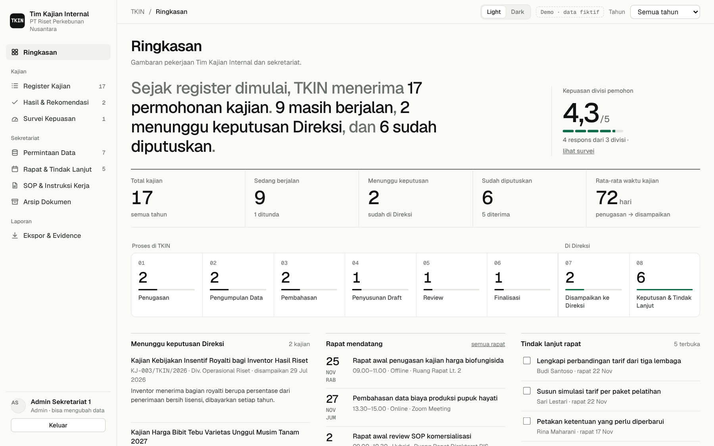
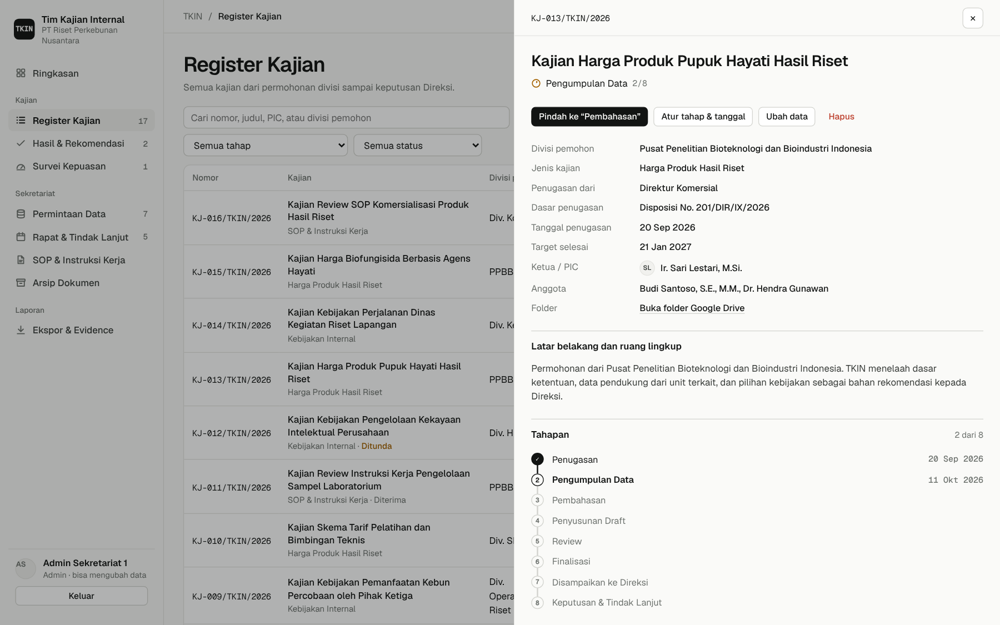
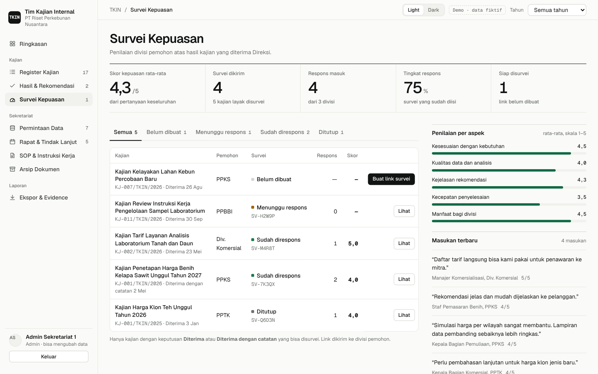
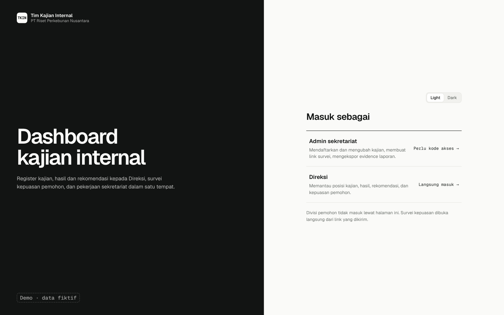
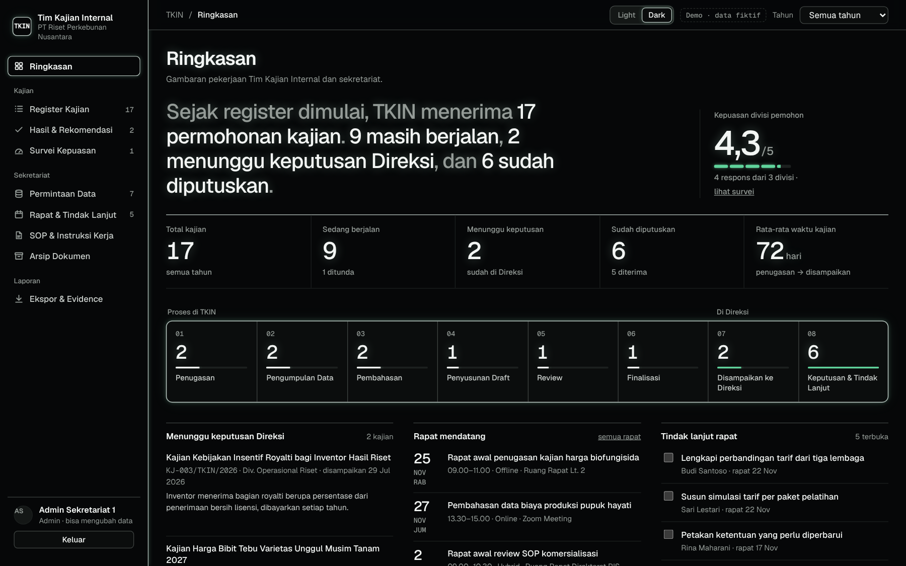

# Dashboard TKIN

A web dashboard for the secretariat of an internal review team (Tim Kajian Internal, TKIN). It tracks every review from the requesting division's application to the Board of Directors' decision, measures requester satisfaction, and produces monthly evidence reports.

**Live demo:** `https://<username>.github.io/<repository>/`

> All data in the demo is fictional and only illustrates how the dashboard works.



## Features

- **Two roles.** *Admin* (secretariat) signs in with a personal access code and can add and edit data. *Board of Directors* monitors progress and results without operational detail.
- **Review register.** Requesting division, review type, lead and team members, manual review number, and an 8-stage workflow with dated history. Stage dates can be entered manually, so past (backdated) reviews can be recorded.
- **Recommendations and decisions.** What was submitted to the Board, the decision (accepted, accepted with notes, re-review, rejected) and the follow-up.
- **Satisfaction survey.** For accepted reviews, the admin generates a survey link for the requesting division. Results are summarised per aspect, with written feedback.
- **Secretariat work.** Data requests to other units, meetings with action items, SOPs and work instructions under review, and a document archive.
- **Export.** Excel or CSV for every list, including a monthly evidence report built from recorded activity.
- **Light and Dark themes.** Dark uses soft glowing white outlines, suited to presenting on a screen.

| | |
| --- | --- |
|  |  |
|  |  |

## Try the demo

1. Open the demo and choose **Admin sekretariat**.
2. Use access code `TKIN-ADMIN1` (to `TKIN-ADMIN5`).
3. Or choose **Direksi** to see the Board's view without a code.

Changes you make in the demo are kept in memory only and reset when the page reloads.

## Tech stack

Vanilla JavaScript (no framework), [Vite](https://vite.dev), [write-excel-file](https://www.npmjs.com/package/write-excel-file) for Excel export, and the Geist typeface via Fontsource.

## Run locally

Requires Node.js 20.19+ or 22.12+.

```bash
npm install
npm run dev            # with fictional sample data
npm run dev:ujicoba    # empty data, saved in the browser (trial mode)
```

## Deploy to GitHub Pages

1. Push this project to a GitHub repository (branch `main`).
2. In the repository, open **Settings → Pages** and set **Source** to **GitHub Actions**.
3. The workflow in `.github/workflows/deploy.yml` builds the demo and publishes it on every push to `main`. The address appears under **Settings → Pages** and in the workflow run.

`vite.config.js` uses `base: './'`, so the build works both at `https://<username>.github.io/` and at `https://<username>.github.io/<repository>/`.

## Project structure

| Path | Contents |
| --- | --- |
| `index.html` | Page shell (sidebar, header, containers) |
| `src/config.js` | Reference lists (stages, review types, divisions, survey questions) and the fictional sample data |
| `src/main.js` | Views, forms, survey, export, sign-in |
| `src/style.css` | Layout, typography, Light and Dark themes |

## Status

This is a working prototype used to agree on content and design with the team. The planned production version will store data in a shared database and replace document links with file uploads.

---

## Bahasa Indonesia

Dashboard untuk sekretariat Tim Kajian Internal (TKIN): register kajian dari permohonan divisi sampai keputusan Direksi, survei kepuasan divisi pemohon, permintaan data, rapat dan tindak lanjut, SOP/IK yang dikaji, arsip dokumen, serta ekspor evidence laporan bulanan. Ada dua peran: **Admin** (masuk dengan kode akses) dan **Direksi** (pemantauan). Seluruh data pada demo adalah data fiktif.

- `npm run dev` / `npm run build`: versi berisi data contoh (untuk demo dan GitHub Pages).
- `npm run dev:ujicoba` / `npm run build:ujicoba`: versi data kosong untuk uji coba input; isian tersimpan di browser masing-masing.
